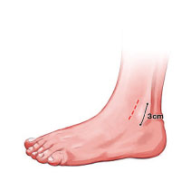
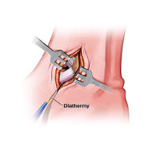
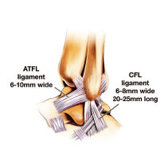
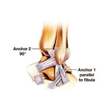
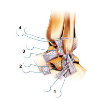

# CLINICAL IMAGES

## MODIFIED BROSTRUM

## Reconstruction

### 1\. Ankle Arthroscopy

Incision placement is anterior border of the fibula, 3cm incision. Blunt  
dissection down to the lateral capsule.

### 2\. Diathermy of bleeding points

The lateral capsule is divided with sharp dissection. The fibula wall exposed  
and the anchor insertion points identified. A flap of tissue is mobilised over  
the fibula.

### 3\. The lateral ligaments

are not dissected as distinct anatomical structures . Rather the lateral wall is  
mobilised as a cuff.

### 4\. The anchors

are inserted into the fibula. Integrant 3.5 mm anchors are used. A blue bone sparing reamer is used and drilled the depth of the anchor. The anchors havea coarse thread and are self drilling in most bone. However if they are inadequately reamed they may become stuck.

### 5\. A needle is cut from each of the sutures.

This facilitates removal of the sutures and is safer for tying which is done by hand. The anchors are tested for purchase by pulling on the threads. Suture 2 is placed first. This allows delivery of the distal cuff into the incision. Its aim is to purchase part of the ATFL and CF ligament. Suture 1 purchases the CF ligament. Suture 3 is for the majority of the ATFL ligament. Suture 4 purchases the anterior portion of the ATFL and capsule and part of the extensor retinaculum. The sutures are then tied with the ankle in eversion from 1-4.
