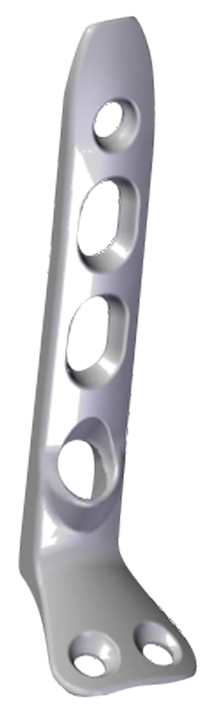
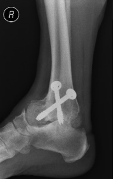
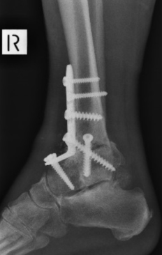
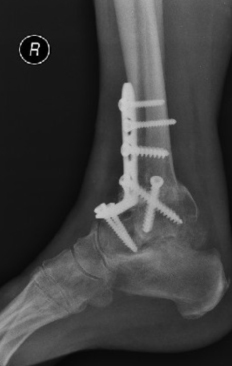
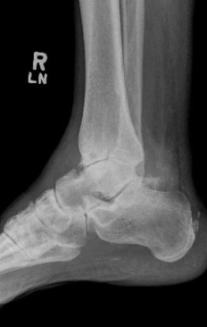
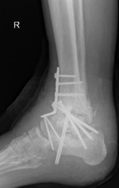
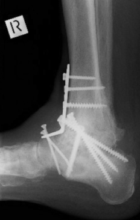

# ANTERIOR ANKLE FUSION SET

**Design Rational**

Anterior Ankle Fusion set includes one Anterior Ankle Fusion Plate and 63 variable screw options. One screw of each of the 3 diameters and 21 different lengths listed below.

**Features**

*   Low Profile
*   Home run screw options
*   Used for primary and revision
*   Able to change intra operatively
*   Able to withstand delayed fusion
*   Anatomically contoured to thetibiatalus surface
*   6 hole plate
*   6 portals with rounded edges to allow for angular variation in screw orientation
*   3 screw diameters
*   21 different lengths

## SAMPLE CASES

**PATIENT NUMBER 1**

### PRE OPERATIVE

### POST OPERATIVE 4 WEEKS

### POST OPERATIVE 3 MONTHS

**PATIENT NUMBER 2**

### PRE OPERATIVE

### POST OPERATIVE 4 WEEKS

### POST OPERATIVE 3 MONTHS

## Surgical Technique

**Surgical Technique for Anterior Plating of Tibia**  
The anterior approach to the ankle has been popularized in total ankle replacements. The technique itself is relatively straight forward. The problem is related to poor wound healing. We have not encountered problems with poor wound healing using the described technique below.

It is important not to undermine the wound edges nor to handle them excessively in the approach, thereby minimizing the trauma to the skin edges.

Further, a period of immobilisation and elevation following the procedure will limit problems with healing. We have found that there are less wound healing problems in fact with the anterior incision than with the lateral incision. Particularly when this was combined with excision of the fibula.

**Positioning of Patient**  
Patient lies supine on the operating table. Thigh tourniquet or mid calf tourniquet has been employed. The leg is exsanguinated.

If a thigh tourniquet is used 350mm of pressure mid calf tourniquet pressure 250mm is regularly employed. A sand bag is placed under the buttock, allowing the ankle to point forwards.

In some circumstances the iliac crest will also be prepped to obtain a bone graft. The bone graft can also be obtained from the proximal tibia, which in many respects preferable unless a structural graft is required, especially in the presence of a substantial loss of the talar body.

**Landmark and incision**  
The medial malleolus and the tibialis anterior can be palpated. An incision is made just lateral to the tibialis anterior as seen in the diagram. The incision is 12cm-15cm long at the anterior aspect of the ankle joint. The midpoint of the incision should be at the ankle joint. The incision is extended dorsally and distally. Initially only skin should be incision and then blunt dissection is made down through the fat to the anterior aspect of diagram ankle joint.

**Internervous plane**  
There is no true internervous plane here. The extensor hallicus longus and the extensor digitrum longus lie in an intermuscular plane. These are both supplied by the deep peroneal nerve. Caution should be employed in avoiding deviation to one side or the other. This intermuscular plane can be used because the nerve supply to these muscles is well proximal to the level of the incision.
