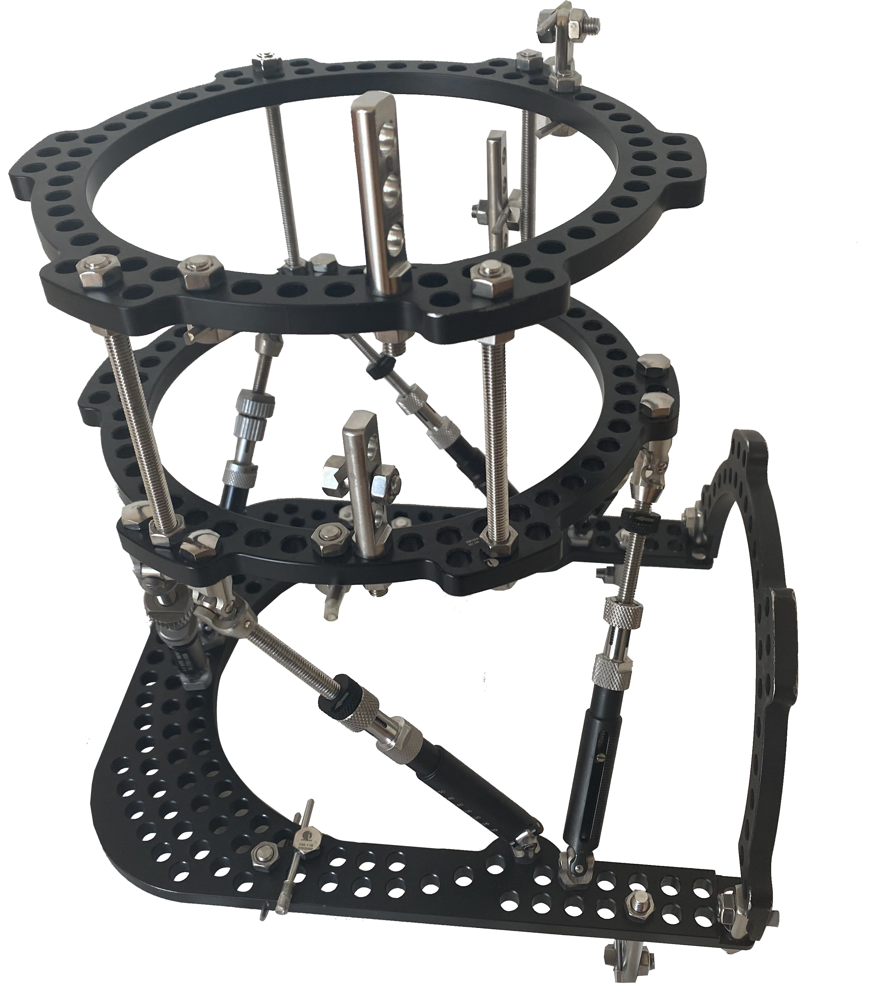
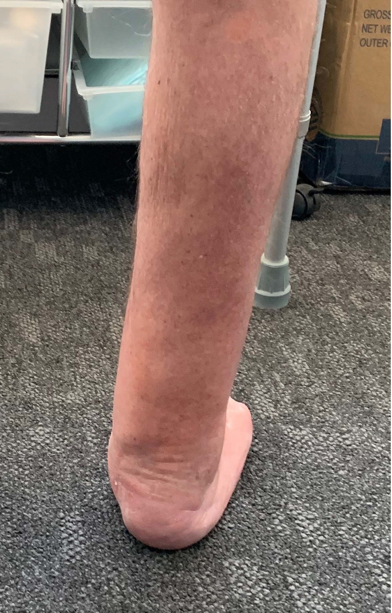
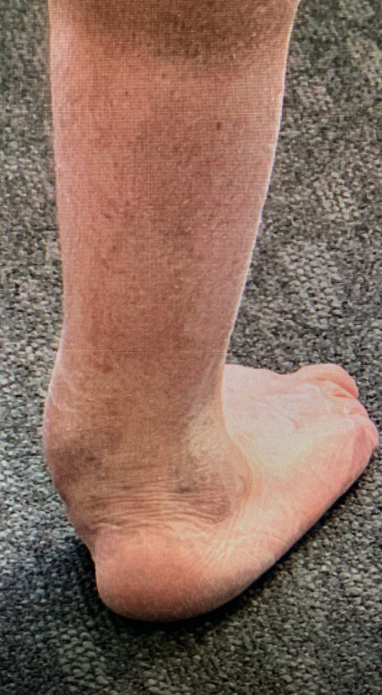

# FrameIT

## External Frame

The FrameIT external frame is designed to stabilize and adjust bone and joints. Where there is a need to relieve stress on joints, to shift bone to an improved alignment, repair advanced fractures or to lengthen bone.

**Applications**

• Charcot Foot (Reduce Amputation Risk)  
• Distraction ”Portable Traction”  
• Fracture Realignment  
• Fracture Non-Union  
• Bone Lengthening  
• Bone Straightening  
• Ankle Arthodesis Advanced  
• Foot and Ankle Realignment

## Why Integrant Frames?

• Specifically designed in consultation with surgeons  
• All equipment required for external frame application  
• Training available  
• Continuous improvement  
• Thicker wires with no need for tensioning  
• In procedure support

