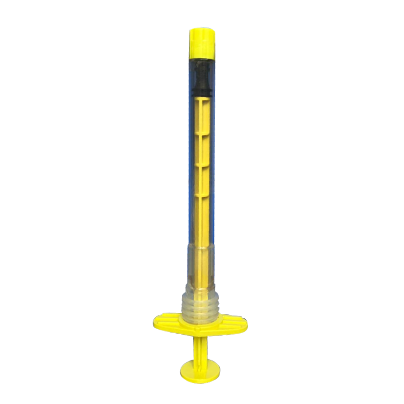

# GRAFIT

## The better alternative for bone healing

• GraftIT is a better alternative for your patients.  
• GraftIT is a natural coralline hydroxyapaptite.  
• It has been used for many years in thousands of cases.  
• It is safe, effective and non-inflammatory alternative to existing grafts.

**Benefits**  
• Eliminates need for donor site  
• Successful use in over 200,000 cases in a variety of fields  
• High osteoconductivity, low resorption as well as promoting on, in and through growth  
• Very similar structure and composition to Human bone  
• Unique syringe delivery apparatus with various attachments

## GraftIT is natural hydroxyapatite and has several advantages:

• GraftIT is injectable.  
• GraftIT is biocompatible with a long history of usage.  
• GraftIT is readily available from renewable sources.  
• GraftIT is easily stored at room temperature.  
• GraftIT does not require complicated preparation protocols. Easy to use.  
• GraftIT is naturally occurring, a mineral form of calcium apatite with the formula of Ca₁₀\[PO₄\]₆\[OH\]₂ which comprises about 50% of the weight of the bone. Therefore has excellent osteoconductive and osteointegrative properties. (Bhatt and Rozental, 2012; Wang and Yeung, 2017).  
• GraftIT has wide pores (macroporosity) allow for adhesion, proliferation, and differentiation  
of osteoprogenitor cells. As well as revascularization, and subsequently ingrowth of new bone (DiDomenico and Thomas, 2015; Roberts and Rosenbaum, 2012; Wang and Yeung, 2017).  
• When GraftIT is soaked in blood and bone chips, healing is enhanced (DIDomenico and Thomas, 2015).  
• Lower risk of infection and immune reactions, unlike allogeneic grafts.  
• Low risk of co-moridity, unlike autograft.

## GraftIT Study

*   [Rodriguez 2018 Barrier Membranes Review](../assets/Rodriguez-2018-Barrier-Membranes-Review.pdf)
*   [Ramanauskaite 2019 Implants and Grafting Review](../assets/Ramanauskaite-2019-Implants-and-Grafting-Review.pdf)
*   [Pountos 2016 Coral Graft Review](../assets/Pountos-2016-Coral-Graft-Review_new.pdf)
*   [McPherson 2019 Coral Bone Graft Review](../assets/McPherson-2019-Coral-Bone-Graft-Review.pdf)
*   [Luo - Performance of Coralline Hydroxyapatite in sinus floor augmentation: a retrospective study](../assets/Luo-Performanceofcorallinehydroxyapatiteinsinusflooraugmentation-aretrospectivestudy.pdf)
*   [Frizzera 2019 Peri Implant Defects Review](../assets/Frizzera-2019-Peri-Implant-Defects-Review.pdf)
*   [Faria-Almeida 2019 Membranes Socket Preservation Review](../assets/Faria-Almeida-2019-Membranes-Socket-Preservation-Review.pdf)
*   [Role of Synthetic Hydroxyapatite-In Socket Preservation: A Systematic Review and Meta-analysis](../assets/Drvivekanand-2019-HA-better-than-Xenograft.pdf)
*   [De Grado 2018 Graft Large Bone Review](../assets/De-Grado-2018-Graft-Large-Bone-Review_new.pdf)
