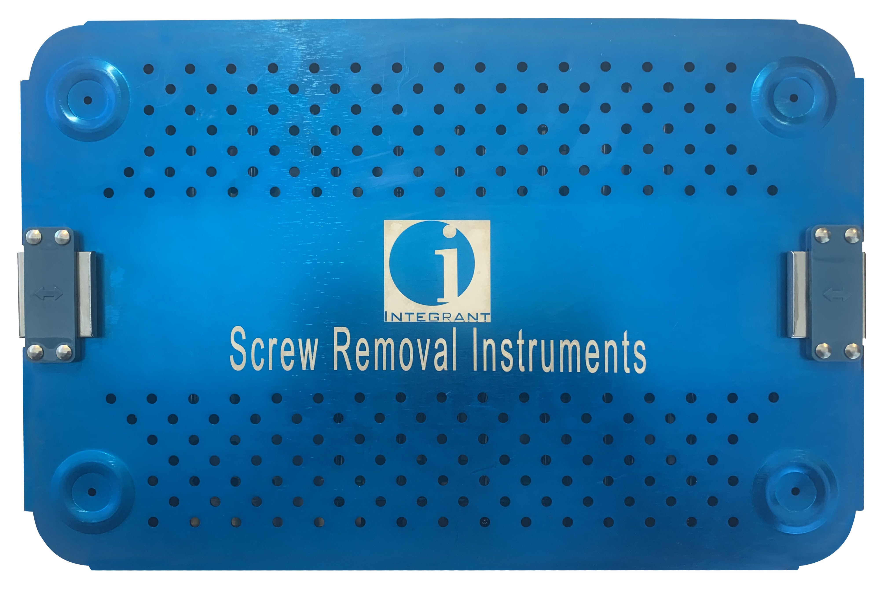
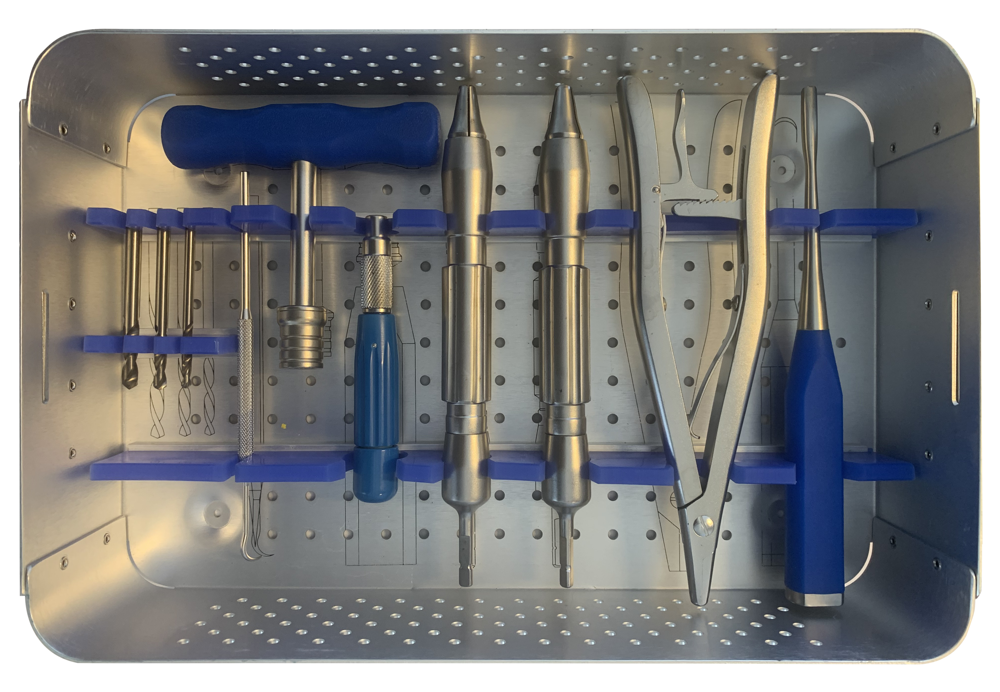
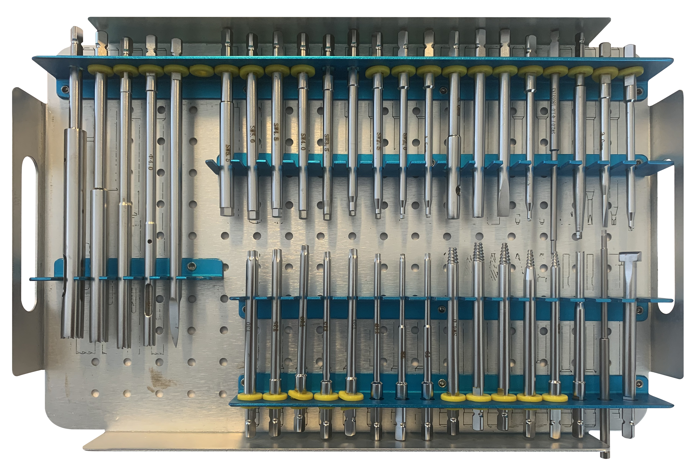

## Integrant Screw Removal Set

All existing Integrant screws can be removed with the instruments supplied in the Screw Removal Set. This prevents delays caused by missing or incorrect instruments.

The screw removal set contains screwdriver shafts for all Integrant screw sizes and drives, as well as extraction instruments for removing broken and damaged screws.

#### The set contains instruments to remove all screws with the following drive recesses:

*   Hex: 1.5 mm, 2.5 mm, 3.5 mm, and 4.0 mm
*   StarDriveTM Recess: T4, T5, T6, T8, T15, T25, and T40
*   Cruciform: 1.0 mm, 1.3 mm, 1.5 mm, 2.0 mm, and 2.4 mm

#### The set contains instruments for removing the following screws:

*   Cortex screws
*   Cancellous bone screws
*   Shaft screws
*   Cannulated screws
*   Locking screws
*   Locking bolts

