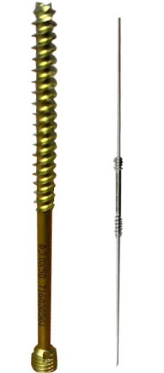
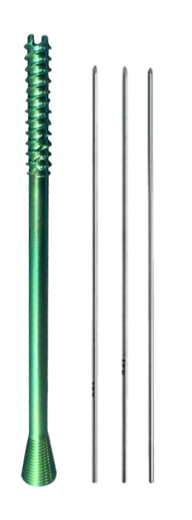
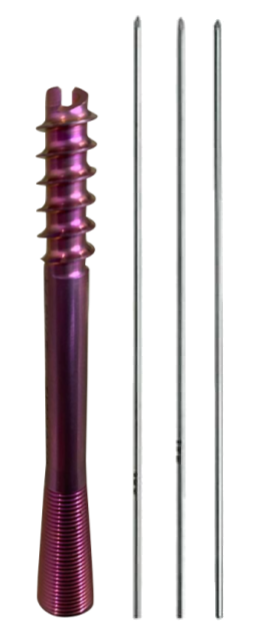

# Integrant Screw Sets​

## Integrant 2.0mm Twist Off Screw

The 2.0 mm twist-off screw is made from titanium and features a self-tapping and self-drilling design. The screw is available in 8 different lengths, either 1mm or 2mm increments.

| Lengths | Catalogue Numbers |
| --- | --- |
| 11mm | \# LA-007-11 |
| 12mm | \# LA-007-12 |
| 13mm | \# LA-007-13 |
| 14mm | \# LA-007-14 |
| 15mm | \# LA-007-15 |
| 16mm | \# LA-007-16 |
| 18mm | \# LA-007-18 |
| 20mm | \# LA-007-20 |

**Surgical Technique – Weil Osteotomy**

An approach was made between extension longus and brevis tendons to the metatarsophalangeal joint. The first phalanx was held in strong plantar flexion and two Homan retractors were set around the metatarsal heads. The lateral ligaments were then re- sected. A small hinged retractor was then set into the same place as the Hohman retractors, protecting the extensors and soft tissue and isolating the metatarsal head. An osteotomy was then made in the transverse plane beginning at the cephalic cartilage but close to its upper border. A cut was made 2.5cm long. A second layer of bone was then removed, approximately 2mm in width, to allow for the shortening and raising of the metatarsal. After cutting the metatarsal head in a backward direction a proximal force was applied to the metatarsal head. A twist off screw was then selected and this was inserted on the AO wire driver collette, securing the osteotomy site. This allowed compression of the osteotomy. The soft tissue balance was then checked, and noted to be correct. Fluoroscan was used to confirm correct cascade at the metatarsals

## Integrant 3.0mm Cannulated Screw System

The 2.0 mm twist-off screw is made from titanium and features a self-tapping and self-drilling design. The screw is available in 8 different lengths, either 1mm or 2mm increments.

| Lengths | Guide Pin Catalogue Numbers |
| --- | --- |
| 14mm | \# LA-008-14 |
| 16mm | \# LA-008-16 |
| 18mm | \# LA-008-18 |
| 20mm | \# LA-008-20 |
| 22mm | \# LA-008-22 |
| 24mm | \# LA-008-24 |
| 26mm | \# LA-008-26 |
| 28mm | \# LA-008-28 |
| 30mm | \# LA-008-30 |
| 32mm | \# LA-008-32 |
| 34mm | \# LA-008-34 |
| 36mm | \# LA-008-36 |
| 38mm | \# LA-008-38 |
| 40mm | \# LA-008-40 |
| 42mm | \# LA-008-42 |
| 44mm | \# LA-008-44 |
| 46mm | \# LA-008-46 |
| 48mm | \# LA-008-48 |
| 50mm | \# LA-008-50 |

###### Triple Cut technology

**Surgical Technique**

Sharp dissection was made down the medial wall of the 1st Metatarsal. A capsulotomy was made at the medial capsule of the 1st MTP joint. Sharp dissection was made through this exposing the medial exostosis. A resection of the exostosis was performed at the sagittal grove. A scarf osteotomy was then performed of the 1st Metatarsal. The intermetatarsal angle was corrected and the distal metatarsal angle was preserved. A 3.0mm screw was inserted into the distal metatarsal in a 60˚ oblique angle. A proximal screw was inserted at 90˚ angle. Fluoroscan was used to confirm correct positioning.

An osteotomy was performed of P1. 4mm of closing was performed correcting the interphalangeus. The P1 osteotomy was fixed with one 3mm screw. Fluoroscan was used to confirm P1 osteotomy positioning. A medial capsulodesis was performed at the 1st MTP. joint with Ethibond 2/0.

## Integrant 4.0mm Cannulated Screw System

The cannulated screw system features a washer and pin. The screw and washer is made from titanium alloy and has a self tapping design. The screws come in a 4.0 mm diameter and offers 23 different lengths to choose from. Lengths listed below

| Lengths | Catalogue Numbers |
| --- | --- |
| 26mm | \# LA-004-26 |
| 28mm | \# LA-004-28 |
| 30mm | \# LA-004-30 |
| 32mm | \# LA-004-32 |
| 34mm | \# LA-004-34 |
| 36mm | \# LA-004-36 |
| 38mm | \# LA-004-38 |
| 40mm | \# LA-004-40 |
| 42mm | \# LA-004-42 |
| 44mm | \# LA-004-44 |
| 46mm | \# LA-004-46 |
| 48mm | \# LA-004-48 |
| 50mm | \# LA-004-50 |
| 52mm | \# LA-004-52 |
| 54mm | \# LA-004-54 |
| 56mm | \# LA-004-56 |
| 58mm | \# LA-004-58 |
| 60mm | \# LA-004-60 |
| 62mm | \# LA-004-62 |
| 64mm | \# LA-004-64 |
| 66mm | \# LA-004-66 |
| 68mm | \# LA-004-68 |
| 70mm | \# LA-004-70 |

###### Triple Cut technology

**Malleoular Fracture Surgical Technique**

**Surgical Technique**

Medial malleoular fracture was expoed and reduced into anatomical position. Two k-wires where introduced under fluoroscopy control. A  
cannulated drill was used to over drill. Two 4.0mm headless compression screws where used to internally fixate the fracture.

## Integrant 6.5mm Cannulated Screw System

The cannulated screw system features a washer and pin. The screw and washer is made from titanium alloy and has a self tapping design. The screws come in a 4.0 mm diameter and offers 23 different lengths to choose from. Lengths listed below

| Lengths | Catalogue Numbers |
| --- | --- |
| 45mm | \# LA-001-45 |
| 50mm | \# LA-001-50 |
| 55mm | \# LA-001-55 |
| 60mm | \# LA-001-60 |
| 65mm | \# LA-001-65 |
| 70mm | \# LA-001-70 |
| 75mm | \# LA-001-75 |
| 80mm | \# LA-001-80 |
| 85mm | \# LA-001-85 |
| 90mm | \# LA-001-90 |
| 95mm | \# LA-001-95 |
| 100mm | \# LA-001-100 |
| 105mm | \# LA-001-105 |
| 110mm | \# LA-001-110 |
| 115mm | \# LA-001-115 |

###### Triple Cut technology
