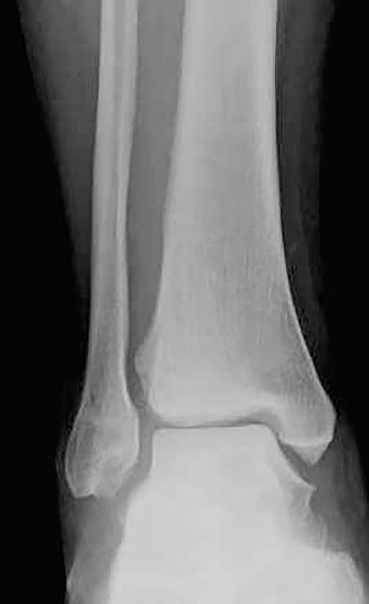
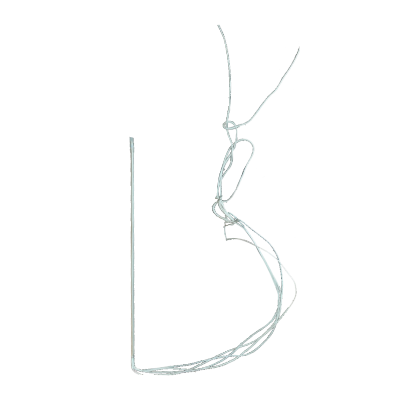
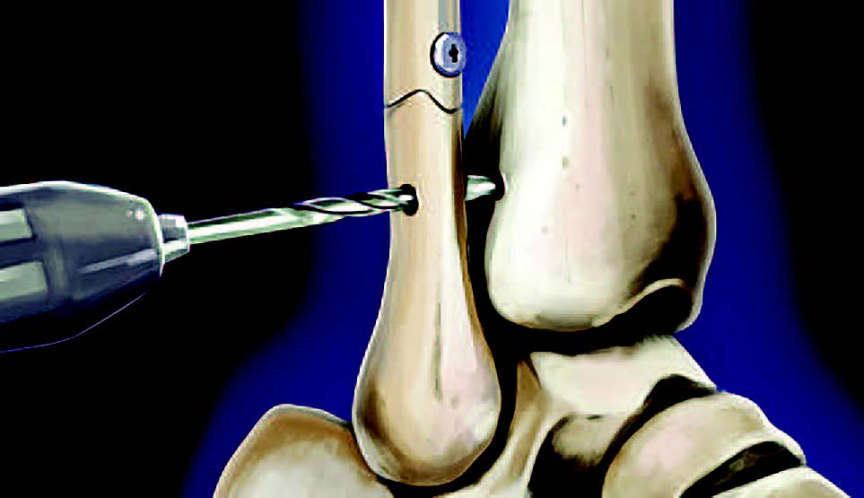
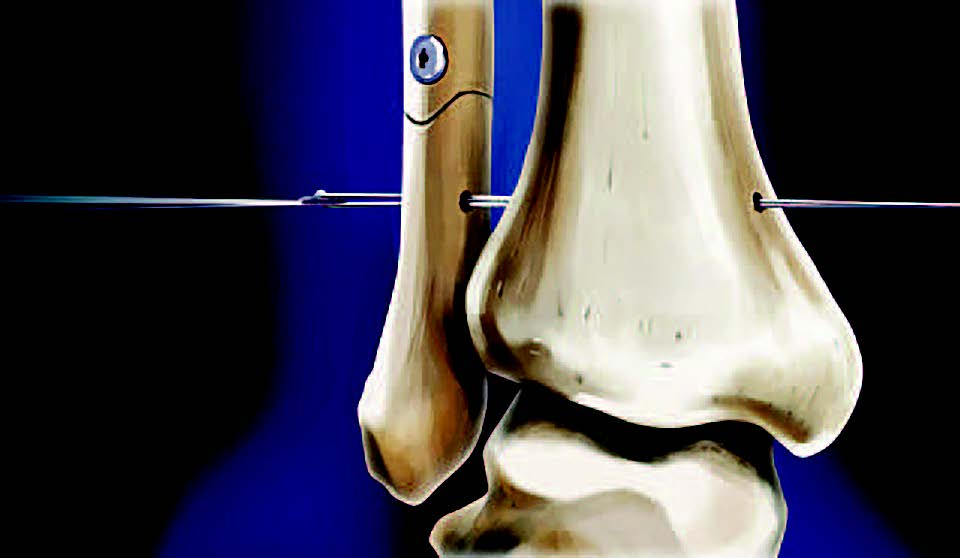
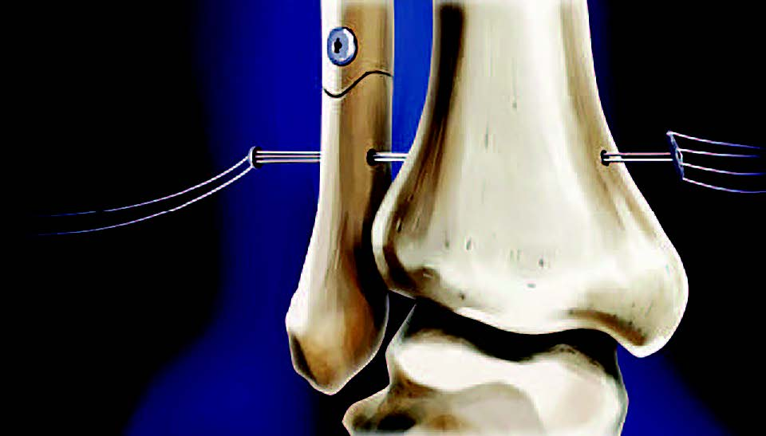
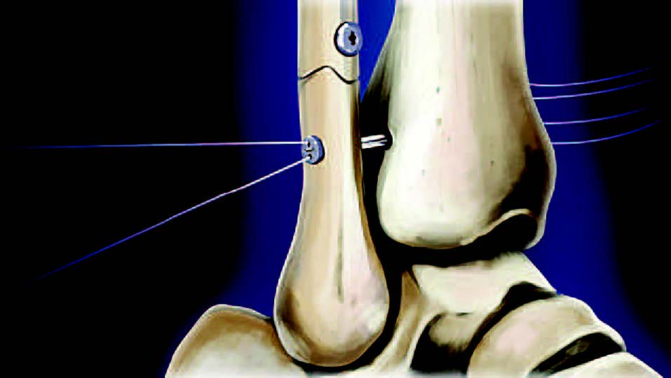
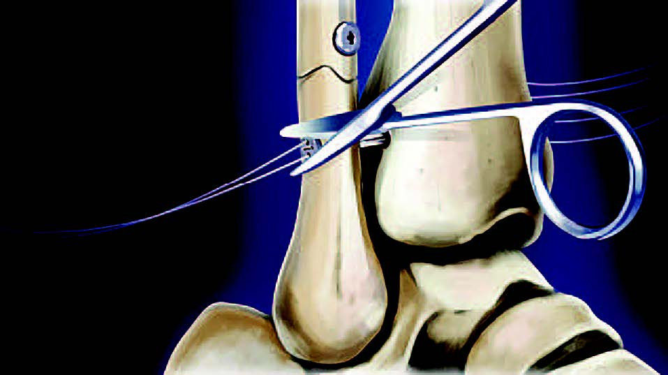

# LoopIT

## Double Loop Lift Implant

### Ankle Syndesmosis Repair

**Ankle Syndesmosis Repair**  
• Equivalent force to screws with less bone stress  
• Rapid rehabilitation, as quick as 2 months  
• Loop buttons low profile, less damage  
• Also for shoulder and other ligaments  
• Does not need to be removed  
• Faster surgical times • Proven technology

Fiberwire and Titanium  
buttons provide strength  
and compatibility

**Hallux Valgus Repair**

• Hallux Vagus and Lisfranc repair  
• Small LoopIT system  
• Technically simple and fast  
• Allows formation of healing tissue  
• Also applicable to hand and wrist

A guide wire and large cannulated drill bit are used to drill a passage for the LoopIT. The passage is normally 1.5 cm above the ankle joint in the transmalleolar plane

The LoopIT is inserted through the guide until the rectangular button just exits. Keep the threads slack during insertion.

Grasp the sutures on the tibial side with gentle tension. Pull coloured sutures down and white sutures up. So that the rectangular button lies flat against the tibia. The sutures on the fibula may need gentle tension to aid this step.

Confirm correct placement of the LoopIT using C-arm Xray. Cut the white suture away. Cut the colored sutures near the knot. Pull the colored sutures alternately on each side (not both atthe same time). Pull the sutures on the fibulaAS side gently but firmly. So that the button sits against the fibula and the joint is firmly secure.

Cut excess suture on both sides.
