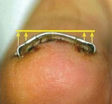

# NaillT

An ingrown toenail is a common disorder. The prevalence of ingrown nails is 26 per 1000 ( from NHIS95 report ), approximately one in 38 (2.6%) or 7.1 million people in the US.

There have been many previous attempts to treat ingrown toenails, wire, and shape-memory devices. However, those devices act similarly to a nail splint while the incurved toenial grows.

There is a difference in the basic concepts of toenail deformity correction. With the NaillT correcting a nail deformity is not like a simple splint during normal growth of the toenail but actually a correction of a nail deformity and its environment.

**Key Features**  
• Ensure the efficiency for treatments  
• Low recurrence rate ( Only 5% )  
• Simple procedure ( Only take 5-15 min )  
• Easy to move in daily life ( patient can run  
one day after surgery)  
• High satisfaction of patient
