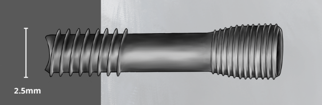

# ScrewIT

## 2.5 mm Cannulated Screw System

**Includes the following:**

*   Cannulated AO-Handle
*   Cannulated Powerdriver
*   Cannulated Hard Bone countersink
*   Cannulated 1.9mm drill
*   2.0mm Drill
*   Depth Gauge
*   0.9 mm Guide wires

**Product Information:**  
The 2.5 mm ScrewIT is a titanium screw designed for the purpose of Forefoot Bone Repairs as well as Hand and Wrist Bone Repairs.

## Screw Features

*   Variable pitch
*   Gentle slope on conical head
*   Sharp fine threads on head
*   Aggressive notch on head
*   Triple cut on lead thread

| Catalogue Numbers | 
ScrewIT Length)

 |
| --- | --- |
| 

MI25-010

 | 

10 mm

 |
| 

MI25-012

 | 

12mm

 |
| 

MI25-014

 | 

14 mm

 |
| 

MI25-016

 | 

16 mm

 |
| 

MI25-018

 | 

18 mm

 |
| 

MI25-020

 | 

20 mm

 |
| 

MI25-022

 | 

22 mm

 |
| 

MI25-024

 | 

24 mm

 |
| 

MI25-026

 | 

26 mm

 |
| 

MI25-022

 | 

28 mm

 |
| 

MI25-030

 | 

30 mm

 |
