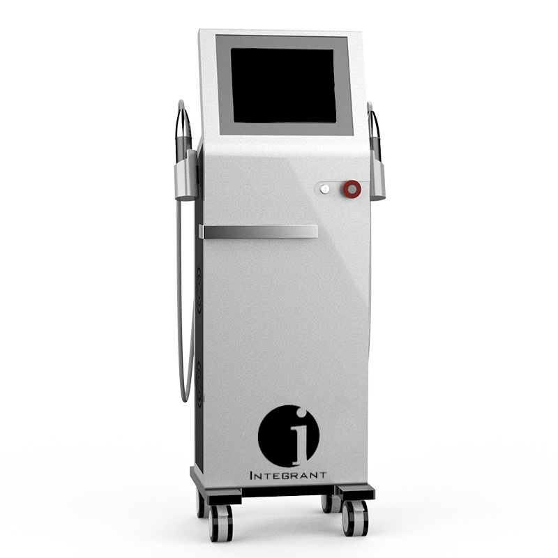
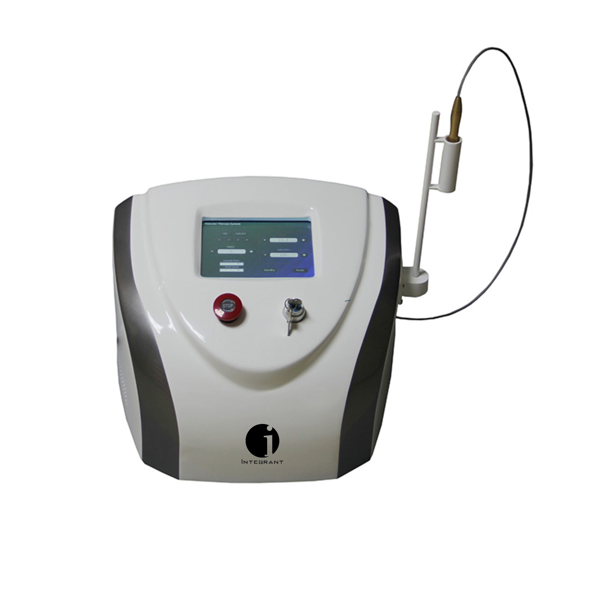

# Radial Extra-corporeal Shock-wave Therapy (rESWT) Machine

## Related products

*    [Read more](https://integrant.com.au/product/radio-frequency-machine/)
    
    Cosmetic Machines[
    
    ## Radio-frequency Machine
    
    ](https://integrant.com.au/product/radio-frequency-machine/)
    
    Rated **0** out of 5
    
    [Read more](https://integrant.com.au/product/radio-frequency-machine/)
    
*    [Read more](https://integrant.com.au/product/vascular-laser-machine/)
    
    Cosmetic Machines[
    
    ## Vascular Laser Machine
    
    ](https://integrant.com.au/product/vascular-laser-machine/)
    
    Rated **0** out of 5
    
    [Read more](https://integrant.com.au/product/vascular-laser-machine/)
    

# Radial Extra-corporeal Shock-wave Therapy (rESWT) Machine

Category [Cosmetic Machines](https://integrant.com.au/product-category/cosmetic-machines/)

*   [Description](#tab-description)
*   [Reviews (0)](#tab-reviews)

The rESWT machine is intended for the treatment of indications with radial, pneumatically generated, low energy acoustic waves or pressure pulses. It uses a compressed air operated ballistic shock wave generator featuring high-precision ballistic components in its applicator for shock wave generation. The motion and weight of the projectile accelerated by compressed air produce kinetic energy that is converted into sound energy when the projectile strikes an unmoved surface (shock transmitter). This acoustic pulse is transmitted directly to the target tissue. Indications include treatment of chronic muscular pain and tendon disorders, erectile dysfunction, cellulite, scars, and stretch marks.

<table width="935"><tbody><tr><td width="157">Specifications</td></tr><tr><td width="157">Pressure: 1.0-5.0 bar (adjustable by 0.1 bar)

General Handpiece: Frequency: 1-22 Hz (adjustable by 1 Hz)

Shocks:

1-8000 shocks (step by 100 or 500 shocks)

Vibrational Handpiece:

Frequency:

1-35 Hz (adjustable by 1 Hz)

Shocks:

1-10000 shocks (step by 100 or 500 shocks)

Machine Dimensions:

565 x 395 x 194 mm

11.3kg

Power Supply: AC100-240V, 50/60Hz
</td></tr></tbody></table>

<table width="935"><tbody><tr><td width="142">Price</td></tr><tr><td width="142">Enquire for price</td></tr></tbody></table>

## Reviews

There are no reviews yet.

Be the first to review “Radial Extra-corporeal Shock-wave Therapy (rESWT) Machine” [Cancel reply](/product/radial-extra-corporeal-shock-wave-therapy-reswt-machine/#respond)
